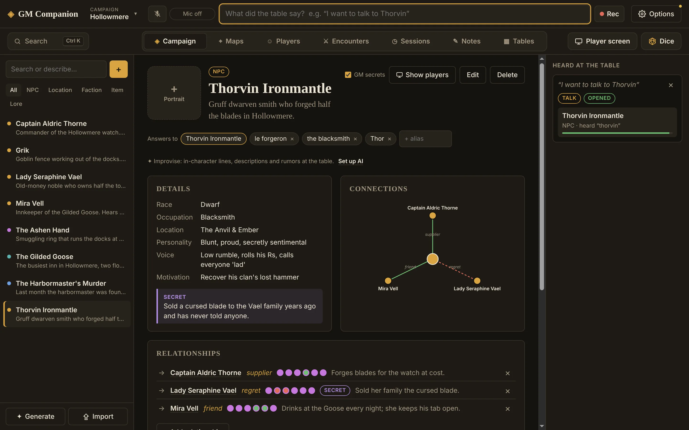

  

<h1 align="center">GM Companion</h1>

  <strong>Every NPC, rule and secret, right when the table needs it.</strong> 
  A desktop app for Dungeons &amp; Dragons game masters.

  <a href="https://github.com/Jeffrey-Kingsbury/gm-companion-releases/releases/latest"><strong>Download the latest version</strong></a>
  &nbsp;·&nbsp;
  <a href="https://[YOUR-DOMAIN]/">Website</a>
  &nbsp;·&nbsp;
  <a href="https://[YOUR-DOMAIN]/pricing/">Pricing</a>

GM Companion keeps your campaign in one place, listens to your players, and opens the right page before you've finished reaching for your notes. When a player says "I want to talk to the blacksmith", that NPC's profile opens on its own: their voice, what they want, their secrets and who they know.

This page is where the installers are published. To learn more about the app, visit the [website](https://[YOUR-DOMAIN]/).

## Download

Go to the [latest release](https://github.com/Jeffrey-Kingsbury/gm-companion-releases/releases/latest) and, under **Assets**, download the file ending in **`.exe`** (for example `GM-Companion-Setup-0.1.6-x64.exe`). The other files in the release are used by the app's automatic updates; you don't need them.

**You'll need:**

- Windows 10 or 11, 64-bit, with about 1 GB of free space
- An internet connection to sign in, then at least once every 14 days
- A microphone, if you want the app to follow the table (optional)

A Mac version is planned.

## Install

1. Run the `.exe` you downloaded.
2. Choose where to install it, or keep the suggested folder. It installs for your Windows account only, so you don't need to be an administrator.
3. GM Companion opens when the installer finishes, and you'll find it in the Start menu.

If Windows shows "Windows protected your PC", that's SmartScreen being careful with an app it doesn't see often yet. The installer is signed: click **More info**, check that the publisher is **Jeffrey Kingsbury**, then click **Run anyway**.

## Getting started

1. **Sign in** with Google or Discord, or with a code sent to your email address. There's no password to remember.
2. **Start your free trial.** New accounts get 7 days free. Checkout opens in your browser; nothing is charged until the trial ends, and you can cancel any time before then.
3. **Follow the short setup.** It creates your first campaign (an empty one, or the Hollowmere demo town to explore), and lets you set up an AI model and the microphone. Only the campaign is required, and everything else can be done later in **Options**.

## What's inside

- **Your world in one place:** NPCs, places, factions, items and lore, with notes, secrets only you see, and who knows whom.
- **It listens to the table:** names, nicknames and roles open the right profile. Speech is understood on your computer, and the audio never leaves it.
- **Encounters:** SRD 5.2 monsters or your own NPCs, difficulty for your party, initiative, HP, conditions, concentration and death saves.
- **Your players:** import D&D Beyond exports or the official fillable character sheet.
- **Sessions:** record the session, keep the transcript, and with an AI model get a recap and a "previously on" for next time.
- **Maps and a player screen:** pin your maps, then show a map, a portrait or the initiative order on a second screen or TV.
- **Dice, roll tables and generators:** 3D dice, nested tables, and instant NPCs, names and taverns.
- **Import and export:** bring in NPCs and places from your PDFs and notes, and export to a web page, PDF or Obsidian vault.
- **AI when you want it:** optional, with your own Claude or ChatGPT key, or a free model on your own computer (Ollama or LM Studio).

## Updates

GM Companion updates itself. It checks for new versions when it starts and every few hours, downloads them in the background, and installs them when you close the app. When an update is ready, a notice offers **Restart now**; it never interrupts a game. You can see your version and check for updates in **Options**.

## Your data

Your campaigns stay on your computer, by default in `%APPDATA%\GM Companion\campaigns`. We never receive them. You can choose another folder in **Options > Advanced**, and back a campaign up by copying its `.db` file, which includes its portraits, pictures and maps. Read the [privacy policy](https://[YOUR-DOMAIN]/privacy/) for the full details.

## Uninstall

Open Windows **Settings > Apps > Installed apps**, find **GM Companion**, and choose **Uninstall**. Your campaigns are kept in their folder, in case you reinstall later; delete that folder yourself if you don't want them anymore.

To cancel your subscription, open **Options > Account > Manage subscription** in the app before uninstalling.

## Help

Write to [[support@gm-companion.com]](mailto:[support@gm-companion.com]). To report a problem, please include your app version (in **Options**) and what you were doing when it happened.

---

GM Companion is independent software and is not affiliated with, endorsed or sponsored by Wizards of the Coast. Dungeons &amp; Dragons and D&amp;D are trademarks of Wizards of the Coast LLC. The app includes material from the System Reference Document 5.2 by Wizards of the Coast LLC, available at <a href="https://www.dndbeyond.com/srd">dndbeyond.com/srd</a>, licensed under <a href="https://creativecommons.org/licenses/by/4.0/legalcode">CC BY 4.0</a>. © [YOUR LEGAL NAME OR BUSINESS NAME]. See the <a href="https://[YOUR-DOMAIN]/terms/">terms of service</a>.
